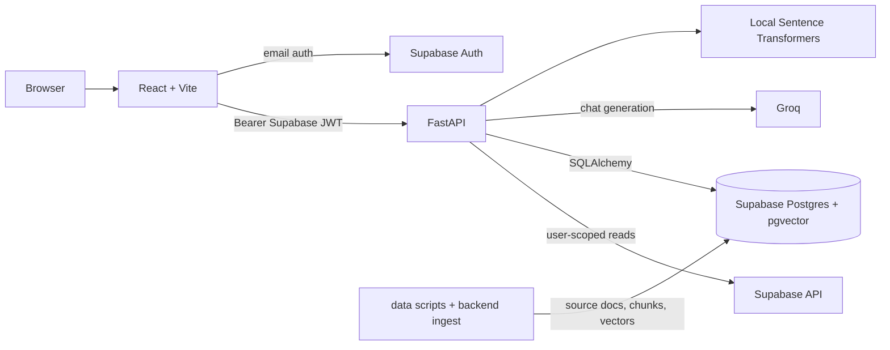

# Document Copilot

Document Copilot is an internal research assistant for asking questions about a curated SEC filing corpus. It returns answers grounded in retrieved filing passages, includes citation metadata and excerpts, and keeps each analyst's chat history. It is not a market-data service and does not make investment recommendations.

## Current capabilities

- Email authentication through Supabase Auth.
- React chat workspace with saved threads, streamed answers, clickable citations, and source excerpts.
- FastAPI routes for thread creation/listing/history and grounded chat streaming.
- Ingestion from local SEC HTML to Markdown, source-document import, Docling chunking, local embeddings, and Postgres storage.
- Hybrid retrieval using 384-dimensional `all-MiniLM-L6-v2` vectors plus PostgreSQL English full-text search, fused by Reciprocal Rank Fusion.
- PydanticAI answer generation through Groq, with citation grounding validation.

The current answer schema is text plus citations and an insufficient-evidence flag. Structured comparison tables are not implemented. Corpus-wide ingestion and client-brief query quality remain unverified; see [the checklist](docs/todos.md).

## Architecture



## Repository map

| Path | Responsibility |
| --- | --- |
| `backend/` | FastAPI, auth, retrieval, PydanticAI, persistence, migrations, and tests. See [backend README](backend/README.md). |
| `frontend/` | Vite/React SPA, Supabase browser auth, API/SSE client, and chat UI. See [frontend README](frontend/README.md). |
| `data/` | SEC download, Docling conversion, source import, and local corpus folders. See [data README](data/README.md). |
| `docs/` | Product brief, architecture, setup guides, phase plans, and request/ingestion details. See [docs index](docs/README.md). |
| `AGENTS.md` | Repository-wide safe coding instructions. |

## Prerequisites and setup

Use Python 3.12+, [uv](https://docs.astral.sh/uv/), Node.js compatible with the frontend Vite version, and pnpm. You need a Supabase project and a Groq API key for live chat. The embedding model is downloaded from Hugging Face on first use. Keep secrets in local env files and out of browser configuration.

### Configure environment

```powershell
if (!(Test-Path backend/.env)) { Copy-Item backend/.env.example backend/.env }
if (!(Test-Path frontend/.env)) { Copy-Item frontend/.env.example frontend/.env }
```

Set backend values in `backend/.env`: `SUPABASE_URL`, `SUPABASE_ANON_KEY`, `SUPABASE_SERVICE_ROLE_KEY`, `DATABASE_URL`, `GROQ_API_KEY`, and `ALLOWED_ORIGINS`. Optional model/base URL settings have defaults in `backend/app/config.py`. `DATABASE_URL` must be the Supabase direct/session PostgreSQL URL for migrations. Set only browser-safe `VITE_API_BASE_URL`, `VITE_SUPABASE_URL`, and `VITE_SUPABASE_ANON_KEY` in `frontend/.env`.

### Install and run

Backend (from `backend/`):

```powershell
Set-Location backend
uv sync
uv run alembic upgrade head
uv run uvicorn app.main:app --reload
```

Frontend (from `frontend/`):

```powershell
Set-Location frontend
pnpm install
pnpm dev
```

The configured, running API exposes `GET http://localhost:8000/health` (no auth required) and FastAPI docs at `/docs`. Vite prints its local URL, usually `http://localhost:5173`.

## Database and migrations

SQLAlchemy metadata lives in `backend/app/database/models/`; reviewed migrations live in `backend/alembic/versions/`. Run migrations from `backend/` using `uv run alembic upgrade head`. Current schema includes users, source documents, document chunks, chat threads/messages, and message citations. `document_chunks.embedding` is the legacy `vector(1536)` field; ingestion and retrieval use `embedding_384 vector(384)`. Do not mix models/dimensions or remove the legacy column without a planned migration and data strategy.

## Corpus commands

Commands below run from the repository root. Downloading uses the SEC downloader's configured contact `USER_AGENT`; edit it to a real contact before use. The download script clears its existing output directory when `CLEAR_OUTPUT_DIR` is true.

```powershell
uv run data/download.py
uv run --project backend --extra ingest python data/convert_to_markdown.py
uv run --project backend python data/import_source_documents.py --dry-run
uv run --project backend python data/import_source_documents.py
```

After source documents exist in the database, preview chunking without database writes, run the one-chunk pilot, then explicitly ingest all filings:

```powershell
Set-Location backend
uv run python -m ingest.load_document_chunks --dry-run
uv run python -m ingest.load_document_chunks --pilot
uv run python -m ingest.load_document_chunks --all
```

`--all` writes to the configured database. Do not point it at production until the pilot and database target have been verified. The downloader/converter/importer and chunk loader are separate stages; no command should be assumed to have run just because it is documented.

## Tests and quality checks

From `backend/`:

```powershell
Set-Location backend
uv run pytest -m "not integration"
uv run ruff check .
```

From `frontend/`:

```powershell
Set-Location frontend
pnpm lint
pnpm build
```

There is no frontend test runner in the current package. Integration tests requiring live Supabase/Groq are marked separately and are not part of the default unit-test command.

## Environment reference

| Variable | Service | Purpose |
| --- | --- | --- |
| `SUPABASE_URL` | Backend | Supabase project API URL. |
| `SUPABASE_ANON_KEY` | Backend | User-scoped Supabase client. |
| `SUPABASE_SERVICE_ROLE_KEY` | Backend only | Privileged backend operations; never expose to browser. |
| `DATABASE_URL` | Backend | Direct/session Postgres connection for SQLAlchemy/Alembic. |
| `GROQ_API_KEY` | Backend only | Groq chat provider credential. |
| `GROQ_BASE_URL` | Backend | Groq OpenAI-compatible API base URL; defaults to `https://api.groq.com/openai/v1`. |
| `GROQ_CHAT_MODEL` | Backend | Main Groq-compatible model ID. |
| `GROQ_GROUNDING_MODEL` | Backend config | Optional grounding model setting; current agent construction uses `GROQ_CHAT_MODEL`. |
| `RETRIEVAL_FTS_KEYWORD_MODEL` | Backend config | Optional setting presently not consumed by retrieval code. |
| `ALLOWED_ORIGINS` | Backend | Comma-separated browser origins allowed by CORS. |
| `VITE_API_BASE_URL` | Frontend | FastAPI origin. |
| `VITE_SUPABASE_URL` | Frontend | Supabase project URL. |
| `VITE_SUPABASE_ANON_KEY` | Frontend | Browser-safe Supabase anon key. |

Backend settings are validated by `backend/app/config.py`; frontend settings by `frontend/src/lib/env.ts`. The frontend must never receive the Groq key, service-role key, or database URL.

## Troubleshooting

- **`No module named app` / `No module named ingest`:** run commands from `backend/` with `uv run`; for `data/` scripts use the root commands above with `--project backend` where shown.
- **`VIRTUAL_ENV` path warning:** `uv` is using the project-local `backend/.venv`; use `uv run` consistently, or `uv run --active` only when intentionally targeting the active environment.
- **Alembic connection failures:** confirm `DATABASE_URL` uses the direct/session endpoint, correct password and URL-encoded special characters, and that the host/port is reachable from your network. Do not use transaction pooler for migrations. No prior connection-error transcript was present in the repository for a more specific diagnosis.
- **Missing/invalid configuration:** compare local files with the placeholder-only `.env.example` files. Never paste actual credentials into issues or logs.
- **No conversation/result:** verify Supabase Auth, the matching thread owner, source-document/chunk ingestion, and backend availability. Empty corpus results are distinct from retrieval/provider errors.
- **Embedding warning/model download:** the first local embedding run downloads model assets. The encoder supports 384 dimensions and ingestion caps chunk text at 254 tokenizer tokens.

## Detailed documentation

- [Architecture](docs/ARCHITECTURE.md)
- [Request lifecycle](docs/REQUEST_LIFECYCLE.md)
- [Ingestion and retrieval](docs/INGESTION_AND_RETRIEVAL.md)
- [Supabase setup](docs/guides/supabase-setup.md)
- [Backend setup](docs/guides/backend-setup.md)
- [Frontend setup](docs/guides/frontend-setup.md)
- [Client brief](docs/client-brief.md)
- [Implementation checklist and known gaps](docs/todos.md)
