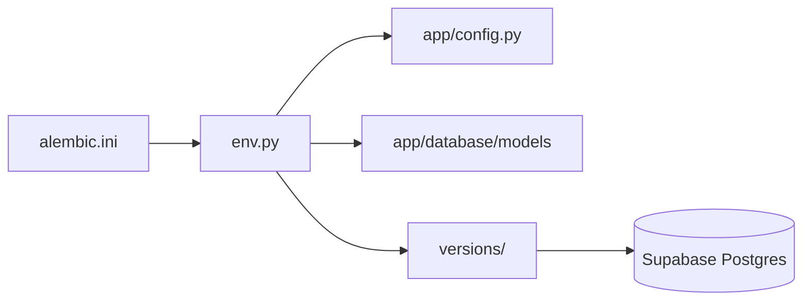

# Alembic migration environment

`env.py` imports `Base.metadata` from `app.database.models`, reads `DATABASE_URL` through application settings, and configures online/offline migration execution. `script.py.mako` is the template for generated migration revisions. `versions/` holds reviewed schema changes; `alembic.ini` at backend root points here and configures migration logging.

Run `uv run alembic upgrade head` from `backend/` using the direct/session connection. Do not apply autogenerated output without checking PostgreSQL-specific pgvector, generated column, index, and RLS operations.
