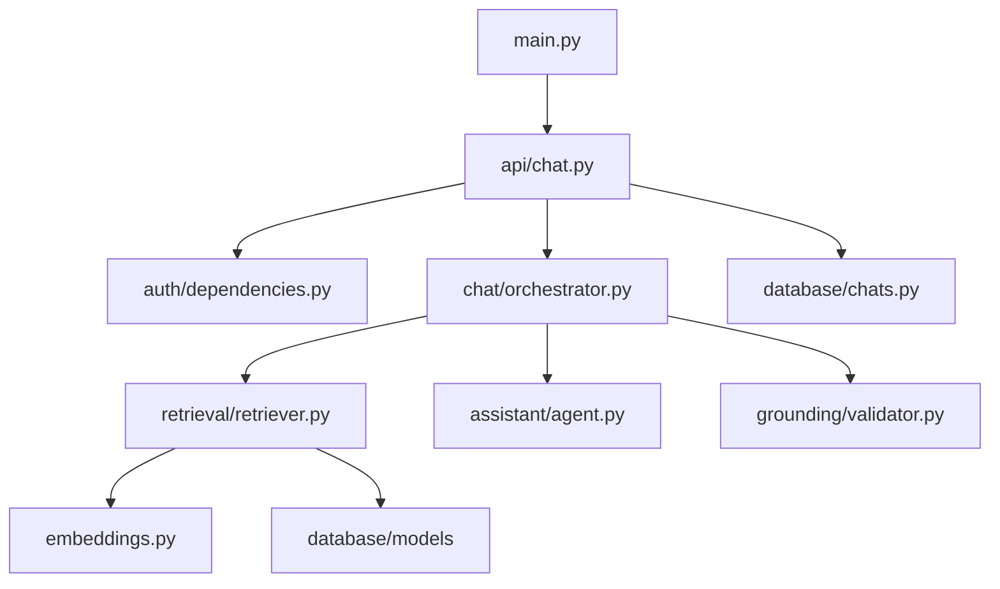

# `backend/app`

Runtime FastAPI package. `__init__.py` marks the importable `app` package. `main.py` constructs the app and mounts `api/chat.py`; `config.py` validates backend environment settings. Runtime behavior is detailed in [architecture](../../docs/ARCHITECTURE.md) and [request lifecycle](../../docs/REQUEST_LIFECYCLE.md).

| Entry | Responsibility and connections |
| --- | --- |
| `main.py` | FastAPI object, CORS middleware, chat router, and `GET /health`. |
| `config.py` | Pydantic settings loaded from `backend/.env`; consumed by API app, Supabase clients, Alembic, and Groq model setup. |
| `embeddings.py` | Shared cached MiniLM document/query encoder, 384 dimensions. Used by ingestion and semantic retrieval. |
| `api/` | HTTP boundary; owns request validation, auth dependencies, orchestration invocation, and SSE response. |
| `auth/` | Supabase bearer-token validation and authenticated-client dependency. |
| `assistant/` | PydanticAI model, tools, typed context/output, and answer policy. |
| `chat/` | One-turn orchestration and AI SDK-compatible message/stream serialization. |
| `database/` | Supabase client factories, SQLAlchemy sessions/models, and chat persistence helpers. |
| `grounding/` | Citation/answer checks and trusted citation metadata mapping. |
| `retrieval/` | Vector/FTS SQL, rank fusion, passage retrieval, and neighbor context. |

Do not put ingestion-only work in request handlers. Preserve API, SSE, citation, and schema contracts when editing these modules.
