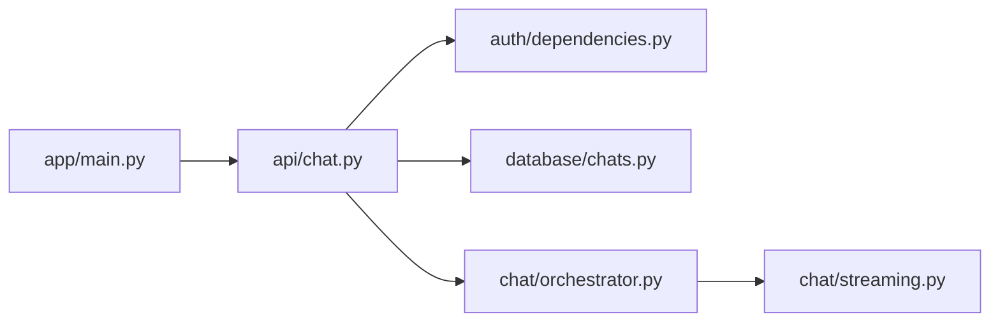

# API routes

`chat.py` is the only current router. It defines authenticated thread list/create/history routes and `POST /chat/stream`; `__init__.py` marks the Python package. `main.py` includes this router and separately defines public `GET /health`.

Handlers validate thread ownership before reading/generating, map boundary errors to HTTP or stream errors, and persist only after answer validation. Keep request field aliases, route paths, auth dependencies, and event framing aligned with `frontend/src/lib/api.ts`.
