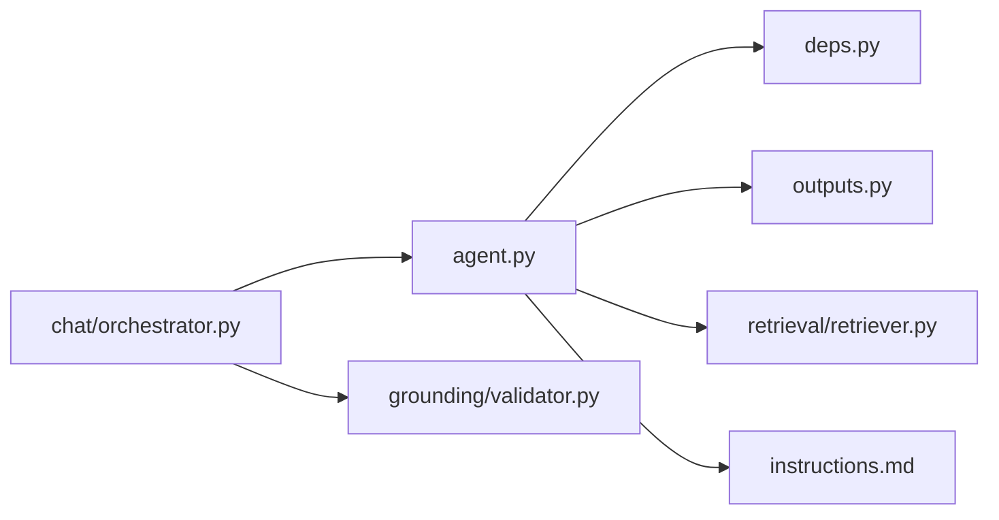

# Grounded answer agent

| File | Role |
| --- | --- |
| `agent.py` | Configures cached PydanticAI agent, Groq-compatible OpenAI provider, and bounded filing search/read tools. Called by `chat/orchestrator.py`. |
| `deps.py` | `DocumentAgentDeps`: authenticated user/thread IDs, session factory, and request-scoped available passage map. |
| `outputs.py` | Pydantic `Citation` and `GroundedAnswer` (`answer`, citations, insufficient-evidence flag). |
| `instructions.md` | Agent's filing-only, cite-every-claim, no-recommendation policy; loaded by `agent.py`. |
| `__init__.py` | Package marker. |

The output contains answer text, citations, and an insufficient-evidence flag; structured answer tables are not implemented. Keep source IDs grounded in `deps.passages`; change instructions, output shape, validator, persistence, and frontend contract together if this output contract changes.
