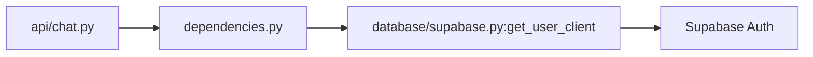

# Authentication dependencies

`dependencies.py` defines the optional bearer scheme, `get_current_user()` token validation through Supabase Auth, and `get_authenticated_client()` which returns the anon-key client configured with the user's JWT. `__init__.py` identifies this package. `api/chat.py` injects these functions on protected routes; `database/supabase.py` constructs the client.

Keep bearer identity authoritative; do not accept a user ID from the browser as proof of ownership. Never log access tokens.
