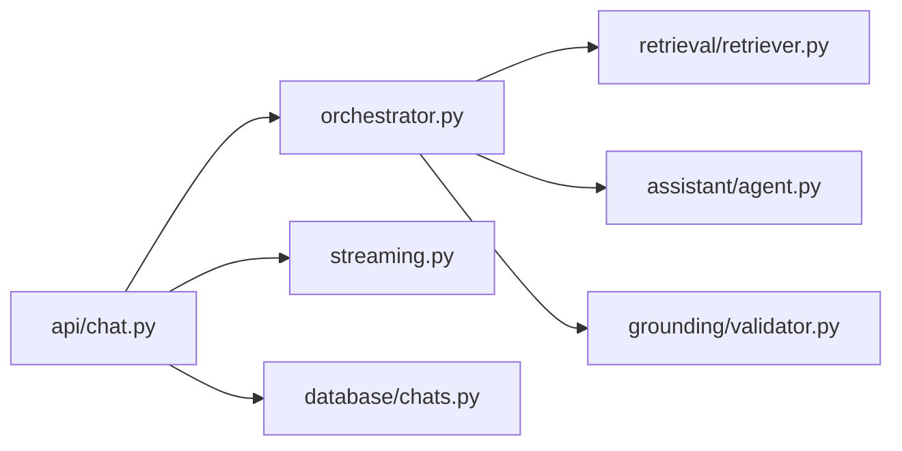

# Chat orchestration and streaming

`orchestrator.py` retrieves passages, invokes the PydanticAI agent, validates the result, and builds trusted citations. `streaming.py` converts validated text/citations into stored UI message parts and SSE events. `__init__.py` marks the package. `api/chat.py` calls the orchestrator and emits its events; `database/chats.py` persists the completed turn.

Validation completes before answer text is sent. Preserve event names and `data-citations` JSON shape expected by `frontend/src/lib/api.ts`.
