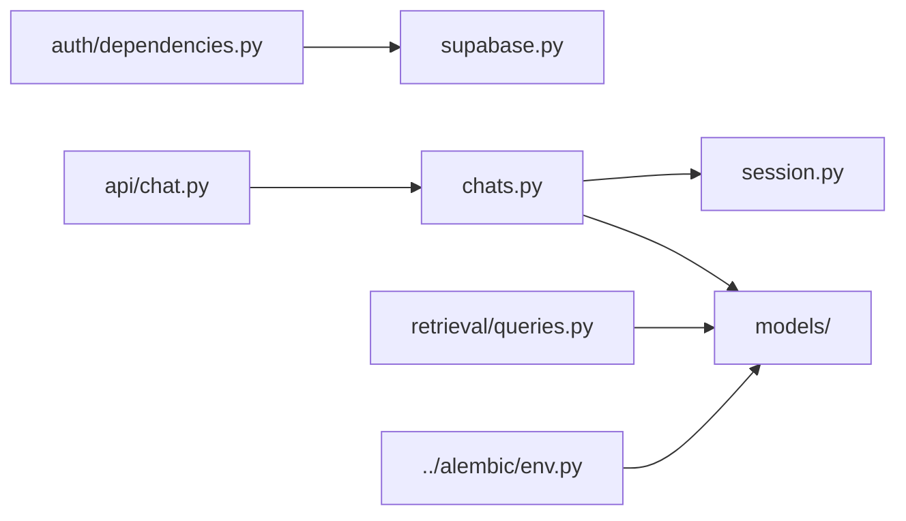

# Database integration

`supabase.py` creates user-JWT and cached service-role Supabase clients. `session.py` lazily creates the SQLAlchemy/psycopg session factory from `DATABASE_URL`. `chats.py` performs thread/message reads and atomic chat-turn persistence. `models/` defines Alembic metadata. `__init__.py` is the package marker.

Supabase REST is used for user-scoped operations; SQLAlchemy is used for retrieval and the persistence transaction. Schema definitions and RLS policies belong in reviewed Alembic migrations, not manually in dashboard state.
