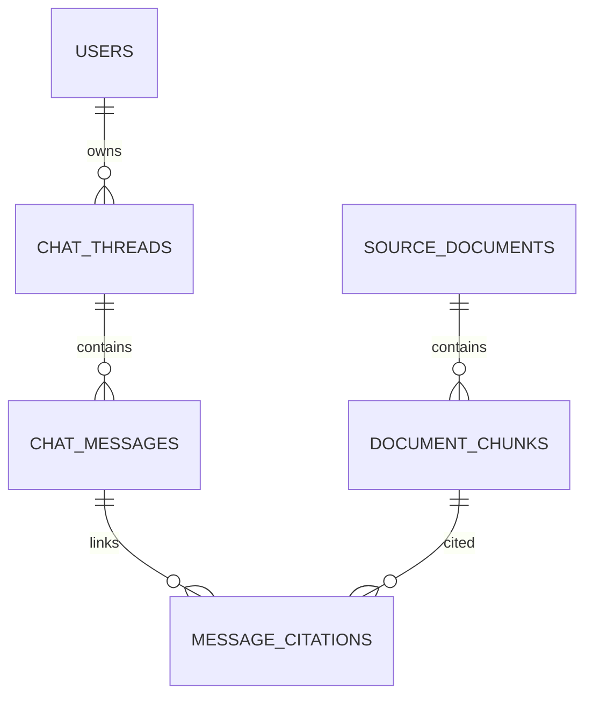

# SQLAlchemy models

`base.py` declares the shared `DeclarativeBase`; `__init__.py` imports and exports every model so `alembic/env.py` can load complete metadata. Each model file maps one table:

| File | Table / relationship |
| --- | --- |
| `user.py` | `users`; primary key corresponds to Supabase Auth user ID. |
| `source_document.py` | `source_documents`; filing metadata and Markdown body. |
| `document_chunk.py` | `document_chunks`; source FK, text, provenance, legacy 1536-vector, current 384-vector, generated English `tsvector`. |
| `chat_thread.py` | `chat_threads`; user FK and timestamps. |
| `chat_message.py` | `chat_messages`; thread FK and JSONB UI message content. |
| `message_citation.py` | `message_citations`; assistant-message and chunk FKs, excerpt, per-message citation index. |

Model edits must agree with Alembic migrations and both vector dimensions/indexes. Existing data and RLS require explicit migration review.
