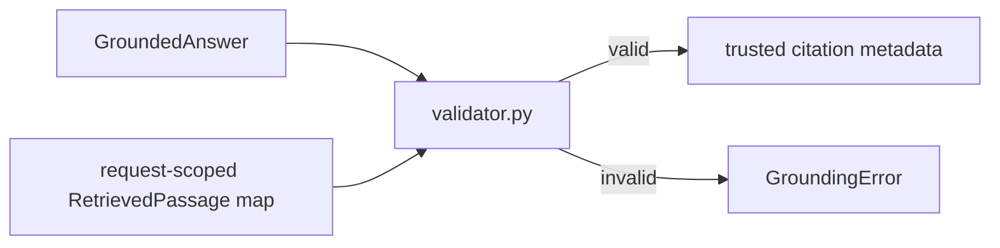

# Grounding checks

`validator.py` defines `GroundingError`, `validate_answer()`, and `trusted_citations()`. It checks citations against passages captured during the current request, including marker/index consistency and excerpt containment. `__init__.py` is the package marker. The orchestrator validates before returning; the route maps grounding failures to a controlled response.

Do not relax these checks to make malformed model output pass; update the tests and answer contract if citation policy changes.
