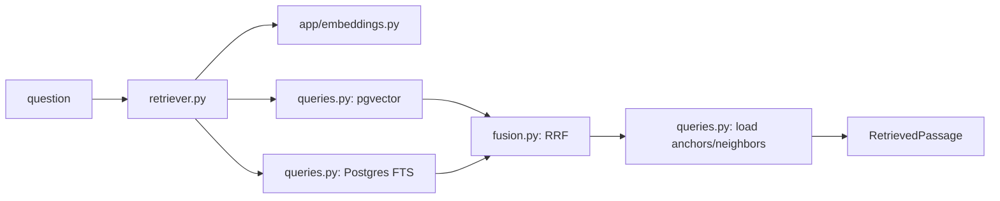

# Hybrid retrieval

| File | Role |
| --- | --- |
| `queries.py` | SQLAlchemy vector cosine and PostgreSQL English full-text searches, filters, chunk loading, and neighbors. |
| `fusion.py` | Pure Python Reciprocal Rank Fusion over independent ranked chunk-ID lists. |
| `retriever.py` | Embeds query, executes/fuses retrieval, attaches filing metadata and adjacent chunks, exposes bounded read methods. |
| `__init__.py` | Package marker. |

Current vector column is `embedding_384` and expected dimension is 384. FTS uses the generated `search_vector`; retrieval runs separate vector and keyword queries and combines ranks. There is no BM25, external reranker, or model-based rerank step. Keep candidate filters, rankings, and source metadata compatible with assistant tools and grounding.
