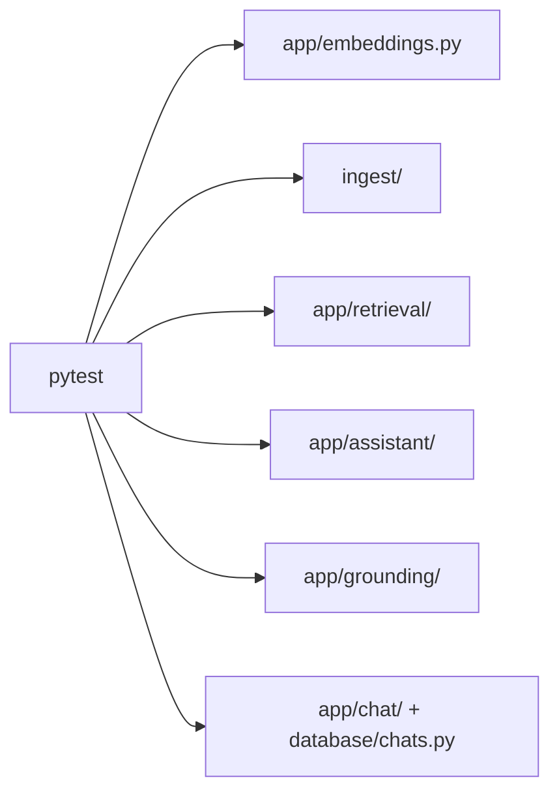

# Backend tests

Pytest tests are offline-focused and mock database/model boundaries. They live beside feature areas:

| Directory/file | Coverage |
| --- | --- |
| `test_embeddings.py` | Shared embedding model/dimension behavior and invalid output dimensions. |
| `ingest/` | Filing metadata and idempotent chunk-current decisions. |
| `retrieval/` | Postgres/vector query construction, RRF ordering, and retrieval/neighbors. |
| `assistant/` | PydanticAI agent construction with an offline test model. |
| `grounding/` | Citation validation, evidence errors, trusted source metadata. |
| `chat/` | Orchestration, stream framing, and persistence boundaries. |

Run from `backend/` with `uv run pytest -m "not integration"`. `pyproject.toml` sets `tests/` as pytest's root and adds the backend directory to import path. Do not add live DB/provider calls to unit tests; mark true integration tests separately.
