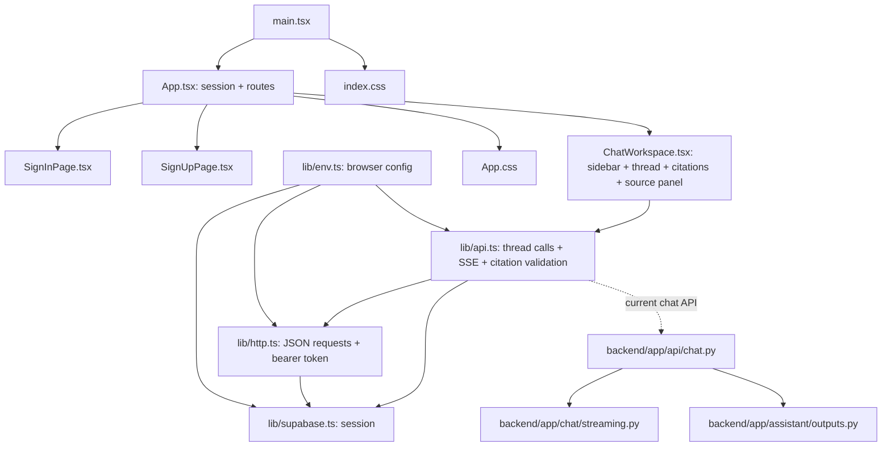

# Document Copilot UI Implementation Plan

**Status:** The initial frontend redesign is implemented in the existing React/CSS structure. Lint and production build pass. Browser interaction and visual review remain pending because browser access is disabled in this session.

## 1. Executive Summary

Document Copilot already has the core workflow needed for a research workspace: Supabase authentication, protected chat routes, thread creation/history, a custom streaming client, validated citation controls, and an excerpt panel linking to SEC filings. The main opportunity is a cohesive visual and responsive redesign of the existing React views and global CSS, not a replacement of their behavior.

The present UI is functional but visually minimal: a light sidebar and chat surface, basic auth cards, generic message treatment, and a narrow-screen source panel overlay. Styling is split between starter global theme rules and app-specific CSS, with purple accents that do not match the proposed editorial palette. At narrow widths, the sidebar remains in the layout instead of becoming a navigation drawer. The backend response contract contains answer text, citations, and an insufficient-evidence flag only; structured comparison tables are not currently supported.

The recommended first implementation is to establish tokens and refine the existing shell, conversation, source panel, composer, and auth pages in place. Keep all current data/API behaviors. Treat the supplied icons as optional assets: they are 512×512 PNGs outside the repository, mostly colorful filled illustrations that do not match the restrained proposed palette. Do not copy or use them until the desired icon style and their license/attribution are confirmed. Standard interface icons can remain text/native controls or use the existing stack; there is no icon library installed.

## 2. Repository and Frontend Overview

- Repository stack and constraints are in [AGENTS.md](../AGENTS.md) and [frontend/AGENTS.md](../frontend/AGENTS.md): Vite, React, TypeScript, React Router, Supabase JS, and hand-authored global CSS. pnpm is the package manager.
- `frontend/src/main.tsx` mounts `App` and imports `index.css`.
- `frontend/src/App.tsx` observes Supabase session state, defines `/signin`, `/signup`, `/chat`, and `/chat/:threadId`, and protects chat routes.
- `frontend/src/pages/SignInPage.tsx` and `SignUpPage.tsx` implement existing Supabase auth flows.
- `frontend/src/pages/ChatWorkspace.tsx` contains both the conversation sidebar and thread view, plus message rendering, composer, citation interaction, and source panel. These are not currently split into shared component files.
- `frontend/src/lib/api.ts` defines the chat/citation types, validates citation data, calls the thread endpoints, and reads the `POST /chat/stream` SSE response. `frontend/src/lib/http.ts` adds the session bearer token to JSON requests. `env.ts` and `supabase.ts` hold browser configuration/client setup.
- `frontend/src/App.css` styles auth, chat, messages, citations, source panel, and responsive rules. `frontend/src/index.css` defines global variables and starter styles, including a separate system dark-mode override.
- `frontend/vite.config.ts` only configures React and the `@` source alias. Tailwind packages are declared but not wired into Vite/current styling. No shadcn/ui, icon library, animation library, chart library, or frontend test runner is installed.
- Existing frontend checks in `frontend/package.json`: `pnpm lint` and `pnpm build` (TypeScript project build plus Vite production build). Manual browser checks are needed for auth and interactive chat behavior.
- `frontend/src/assets/` currently contains `hero.png`, `react.svg`, and `vite.svg`; none of the 12 supplied icon PNGs are present there.

### Current frontend relationship diagram



## 3. Current UI Audit

### Existing pages and behavior

| Area | Existing implementation | Assessment / focused improvement |
|---|---|---|
| Route and session shell | `src/App.tsx` loads Supabase session and protects chat routes. | Preserve route behavior and session flow; style its loading state consistently. A separate route/layout refactor is unnecessary for the visual task. |
| Sign-in/sign-up | `src/pages/SignInPage.tsx`, `SignUpPage.tsx`; labeled fields, Supabase calls, submitting, status/error, and cross-links. | Core flow exists. Align form surface, type, spacing, and focus/error styles with the workspace. Password visibility and reset-password are not present; do not add unless separately requested. |
| Conversation navigation | In `ChatWorkspace.tsx`: new chat, thread list/active link, loading/empty/error state, account email, sign out. | Useful functionality already exists. Refine hierarchy and active state; at mobile widths provide a usable drawer/overlay rather than leaving a fixed sidebar. Search and grouping are not implemented; do not show pretend controls. |
| Thread and messages | Same page: history fetch/retry, distinct user/assistant classes, no-message screen, streaming placeholder, error display. | The existing structure is usable. Improve reading width, question/answer hierarchy, spacing, streaming stability, and error/empty state styling instead of creating new chat behavior. |
| Composer | Multiline textarea, Enter submits, Shift+Enter inserts newline, disabled while loading/streaming, send indicator and caution note. | Preserve these behaviors. Refine persistent placement and focus/disabled states. No upload or attachment behavior exists. |
| Citations/source | `api.ts` validates citation entries; `ChatWorkspace.tsx` turns known `[n]` markers and citation chips into buttons, opens exact excerpt/metadata and a validated HTTPS SEC link, supports Escape/close/focus return. | Trust-critical behavior is already present. Preserve validation, text-only rendering, source URL guard, and trigger focus handling; restyle rather than replace. |
| Responsive behavior | `App.css` has breakpoints at 480, 640, and 900px. Sidebar narrows at small width; source panel becomes an absolute overlay below 900px. | Existing rules prevent some squeezing, but there is no proper sidebar drawer. Verify actual viewport overflow and panel interaction before finalizing mobile behavior. |
| Global style | `index.css` has starter typography and colors plus `prefers-color-scheme: dark`; app styles separately declare a light chat theme with purple citation/focus accents. | The competing theme variables and hard-coded page colors need consolidation into one intentional token system. Ensure the selected light palette stays consistent regardless of OS theme unless explicit theme support is designed. |
| Iconography | Sidebar/thread/send/close indicators include text glyphs; no icon package is installed. | Replace glyphs only where a real icon improves clarity. Supplied PNGs are illustrative and visually inconsistent; they are not a ready-made interface icon set. |

### Main visual issues to address

1. Auth and chat surfaces use separate styles and inconsistent visual density; create shared tokens and consistent control styling in `index.css` / `App.css`.
2. The default large global heading scale and the current compact chat styles do not form one deliberate type hierarchy; tune sizes and line lengths for both auth and answer reading.
3. User messages use generic gray bubbles while assistant answers are transparent, with purple citations against the otherwise neutral interface; refine answer-as-research-note hierarchy and citation treatment without changing content.
4. Sidebar and source panel rely on generic grey surfaces and borders; recompose them around the restrained graphite/ivory/teal palette with dividers and clear active/focus states.
5. Current mobile treatment leaves navigation narrow and persistent; introduce a real accessible drawer/overlay with open/close state if implementation confirms the current layout is unusable at mobile widths.
6. The code has distinct loading, empty, and errors already, but these states share minimal text styling; visually distinguish them without changing their meaning or inventing backend states.

## 4. Existing Functionality to Preserve

- Supabase session initialization, sign-in/sign-up, session redirects, and sign-out.
- Protected `/chat` and `/chat/:threadId` routes and current URL behavior.
- Thread creation/listing, history loading/retry, and post-stream history reload.
- `POST /chat/stream` request shape (`threadId`, messages) and Supabase access-token bearer header.
- Existing SSE parsing for `text-delta`, `data-citations`, backend errors, and `[DONE]`, including the network/error handling in `api.ts`.
- Citation boundary validation, safe text rendering, citation markers/chips, source-panel metadata/excerpt, HTTPS SEC URL restriction, Escape close, and focus return.
- Composer Enter/Shift+Enter behavior, disabled/loading state, and no-evidence/error messaging.
- Backend contract and data persistence. `backend/app/assistant/outputs.py` defines `GroundedAnswer` as `answer`, `citations`, and `insufficient_evidence`; `backend/app/chat/streaming.py` streams text and citation data. Do not change these as part of a frontend visual redesign.

The current frontend does not implement stream cancellation. A redesigned interface must not imply cancellation until it is actually implemented. The current backend does not return structured comparison rows, metric values, or cell citations, so no factual table can be rendered from the existing response contract.

## 5. Downloaded Icon Inventory

All 12 user-provided files were found at `C:\Users\Osamah\Downloads\`. They are PNG files, each 512×512 pixels, and have been copied into `frontend/src/assets/icons/`. Eight are used in existing UI contexts; the rest remain available but are not surfaced because they suggest unsupported controls or data. Download source/license metadata was not provided, so usage/attribution terms remain unverified.

| Asset filename | Format / size | Observed visual style | Potential use | Recommendation and integration notes |
|---|---|---|---|---|
| `verified.png` | PNG, 512×512 | Filled shield, green check, blue label; bold multicolor illustration | Maybe a verified-evidence decoration/status | **Optional; not recommended as a status icon.** The UI has no separate verified badge contract and this detailed illustration is too loud for inline evidence. Citation controls already indicate sources. |
| `file.png` | PNG, 512×512 | Cyan document with yellow upload badge | Upload/select document | **Do not use currently.** No file upload feature exists; adding it would imply unsupported behavior. |
| `gears.png` | PNG, 512×512 | Filled orange/yellow gears, dark outlines | Settings | **Do not use currently.** No settings route/control exists. |
| `user.png` | PNG, 512×512 | Cyan-to-blue outline user glyph | Account/profile | **Optional.** Could replace the initial avatar only if kept small and legible; current app has email/sign-out but no profile page. A simple CSS initial may fit better. |
| `text-analytics.png` | PNG, 512×512 | Document with magnifier; pale fill, dark strokes, blue details | Research/document analysis | **Optional product illustration only.** Too detailed for a compact control; the app already has a research/chat workflow and should avoid decorative clutter. |
| `table.png` | PNG, 512×512 | Multicolor grid with thick dark outlines | Structured result/table | **Do not use for current answers.** There is no structured table response in the backend contract. If a table feature is later built, prefer semantic HTML table styling and a consistent small icon only if needed. |
| `link.png` | PNG, 512×512 | White chain link on saturated blue circular gradient | External source link | **Not recommended.** It is a large multicolor badge, unlike a small inline/link action; retain a native text link or use consistent UI iconography. |
| `application.png` | PNG, 512×512 | Dark outline browser/app window | App/workspace | **Optional, low priority.** Existing app identity and navigation do not need a large illustration. If used, test dark strokes against chosen surfaces. |
| `message.png` | PNG, 512×512 | Preview appears dark/monochrome and is not legible on its displayed background | Message/chat | **Pending visual verification; do not integrate yet.** Inspect alpha/background and visible glyph on both light/dark surfaces first. |
| `search (1).png` | PNG, 512×512 | Filled pale-blue magnifier with orange handle | Search | **Do not use currently.** Conversation/document search UI is not implemented; the file is an illustration rather than a compact icon. |
| `database.png` | PNG, 512×512 | Preview appears dark/monochrome and is not legible on its displayed background | Database | **Pending visual verification; not needed in user-facing workspace.** Backend/storage architecture is not a user action. |
| `search.png` | PNG, 512×512 | Folder/document with pale magnifier and yellow/purple-gray fills | Search files/documents | **Do not use currently.** No search control exists and it would introduce a false affordance. |

### Icon integration decision

The implementation uses `application.png` for product identity, `message.png` for thread rows, `user.png` for the account avatar, `text-analytics.png` and `search.png` in research empty states, `file.png` to identify the SEC corpus, `verified.png` alongside the cited source passage, and `link.png` for the working SEC link. The PNGs remain original assets and render at small sizes. `gears.png`, `table.png`, `search (1).png`, and `database.png` are copied but intentionally unused because they imply settings, structured answer tables, search controls, and database features that are not available as UI actions. Confirm license and attribution before distribution. Do not recolor raster assets with CSS filters.

## 6. Proposed Design System

Use the palette in the request as a starting point, not an assumed accessibility pass:

| Token role | Proposed starting value | Application |
|---|---|---|
| Main background | `#F5F3ED` | Overall workspace and auth backdrop |
| Reading surface | `#FFFEFA` | Thread answer area and forms |
| Navigation | `#202724` | Sidebar, with checked foreground contrast |
| Primary text | `#252A27` | Headings and body |
| Secondary text | `#777B73` | Metadata and helper text; adjust if contrast fails |
| Primary accent | `#176B60` | Primary actions, citations, links, active/focus details |
| Accent hover | `#12564D` | Interactive hover/pressed state |
| Brass highlight | `#B59A62` | Sparse metadata detail, never large surface |
| Border/divider | `#DDDCD3` | Thin separators and control boundaries |
| Semantic status | Accessible muted green/amber/red | Success, warning, and error; do not signal by color alone |

Define these as a small set of CSS custom properties in `index.css`; use `App.css` for view-specific layout and component states. Add consistent type scale, line height, spacing, border, radius, shadow, focus-ring, and transition tokens. Use the current system sans stack unless a bundled/available font is confirmed; do not add a remote font dependency by assumption. Use tabular numerals for financial values if/when such values are provided. Use serif body typography only if browser review confirms it improves long-form answer readability.

The current base CSS applies a dark-mode media override, while `App.css` hardcodes a light chat UI. Decide during implementation whether to keep the product explicitly light for visual consistency or support a complete dark theme; do not leave a partial OS-driven theme.

## 7. Page and Component Design Recommendations

### Auth screens

Keep the current compact, focused forms and Supabase submission/state. Align their surface, labels, inputs, errors, and actions with the workspace tokens. Keep form labels and existing status/error semantics. Do not add marketing hero content, social auth, password reset, or password visibility controls without a separately supported interaction requirement.

### Authenticated workspace

- **Sidebar:** clear brand/caption, visible New chat action, conversation heading, active thread state, scrollable history, and anchored account/sign-out. Keep current thread title fallback and actual data only. On mobile, use an accessible drawer with a backdrop, close action, Escape handling, focus behavior, and no page overflow.
- **Conversation:** distinguish the analyst's question from the research answer without oversized colored chat bubbles. Keep the answer measure readable, make the conclusion/paragraph structure easy to scan, preserve newlines, and keep citation controls adjacent to the relevant answer text.
- **Source inspection:** preserve the current metadata and exact excerpt. At wide widths, reserve space without squeezing the answer; at narrow widths, use the existing overlay concept with a visible backdrop/close interaction and keyboard behavior verified.
- **Composer:** keep the multiline input, Enter/Shift+Enter, submit lifecycle, disabled states, and warning. Use a restrained surface and persistent location with visible focus; do not add upload/model controls.
- **Empty/error/loading states:** style the existing states for no threads, empty thread, history loading/error, stream waiting/receiving, network/service/persistence errors, and insufficient evidence. Add retry only where an existing retry path is available; do not invent states from server data that is not supplied.

### Tables and answer evidence

The table icon and requested data-table presentation must not drive a fake frontend table. The backend currently returns a plain answer plus citation metadata and `insufficient_evidence`. Before a real comparison table can be displayed, the backend must define and validate structured values and evidence per row/cell, and persist/stream/reload that type consistently. Until that dependency exists, use the existing answer and citations and document the structured table as out of scope for this frontend-only pass.

## 8. File-by-File Change Map

Only existing files are listed below unless marked **proposed new**. Exact edits should be limited to what implementation needs.

| File/component | Current responsibility | Proposed change | Reason | Dependencies or risks |
|---|---|---|---|---|
| `frontend/src/index.css` | Global font/color variables, base element rules, OS dark-mode override. | Consolidate/rename the small token set, set intentional type/base defaults, resolve the partial dark-mode mismatch. | One shared source for design tokens. | Contrast must be measured; global defaults affect both auth and chat. |
| `frontend/src/App.css` | Auth, chat shell, sidebar, messages, citations, source panel, composer, responsive rules. | Rework these existing styles around the tokens; add mobile drawer/backdrop and focus/reduced-motion rules if needed. | Most visual behavior is already here; avoid a new styling system. | CSS scope is broad; test all routes and breakpoints after changes. |
| `frontend/src/pages/ChatWorkspace.tsx` | Sidebar and chat state/rendering, stream lifecycle, citations/source panel, composer. | Make only interaction changes needed for mobile navigation/source overlays and accessible open/close state; preserve API and message logic. | Current markup supports the intended regions but has no sidebar drawer. | Avoid disrupting citations, Escape/focus behavior, history reload, or streamed rendering. |
| `frontend/src/pages/SignInPage.tsx` | Supabase sign-in form and feedback. | Adjust markup only if a real visual/accessibility need requires it; maintain labels, validation, state, and route links. | Keep auth screen consistent with workspace. | Avoid touching auth behavior. |
| `frontend/src/pages/SignUpPage.tsx` | Supabase sign-up form and feedback. | Adjust markup only if needed; maintain signup/confirmation behavior and links. | Keep auth screen consistent with sign-in. | Avoid touching Supabase behavior. |
| `frontend/src/assets/*.png` (**proposed, conditional**) | Existing directory contains starter/hero files; supplied icons are currently in Downloads. | Copy only individually approved assets, likely none initially. | Keep assets bundled only when they have an actual UI role. | Confirm each asset license/attribution; do not copy all 12 by default. |
| `docs/` (**this plan**) | Product and implementation documentation. | Track the planned scope and later update status only after verified implementation. | Separate plan from code state. | This document does not mean work is implemented. |

No new reusable component file is currently necessary: the workspace is composed within `ChatWorkspace.tsx` and the task can begin by adapting its existing structure. If that file becomes difficult to maintain during a real implementation, extract only a component with repeated or independently complex behavior and update the diagram then. No backend file, database model, migration, route schema, or environment config is in scope for the visual redesign.

## 9. Icon Integration Strategy

1. Keep the 12 originals in Downloads until individual assets are approved; they are not part of the project tree.
2. Confirm asset license and required attribution from the actual download/source record. Filenames alone do not establish rights.
3. Prefer no image icon for controls whose current behavior is text/native (New chat, send, close) unless a consistent small symbol clearly improves comprehension.
4. Do not use upload, settings, search, database, table, or verified illustrations to suggest features or status that the app does not support.
5. If `user.png` or another approved asset is selected, preview the actual transparent PNG on the intended surface, confirm visible size/contrast, provide suitable accessible treatment, and avoid nonfunctional decorative controls.
6. Keep any accepted asset file names stable and imports local; verify no broken Vite paths and test the rendered contrast/size in browser.

## 10. Ordered Implementation Phases

| Phase | Objective and relevant files | Expected outcome | Dependencies | Verification / risk |
|---|---|---|---|---|
| 1. Baseline and token foundation | Review `index.css`, `App.css`; capture current screenshots at desktop/mobile; then consolidate tokens. | One coherent palette/type/spacing/focus foundation, with no route or behavior changes. | Approved visual direction; contrast check. | Run lint/build; compare auth, empty chat, thread, and source-open states. Global CSS regressions are the main risk; revert token-only changes independently if needed. |
| 2. Workspace shell and navigation | `ChatWorkspace.tsx`, `App.css`. | Premium sidebar/content composition and active state; usable mobile navigation drawer. | Existing thread data and route behavior. | Test new thread, select old thread, sign-out; keyboard open/close and narrow widths. Keep route/list logic unchanged. |
| 3. Answer, citations, and source panel | `ChatWorkspace.tsx`, `App.css`. | Readable answer hierarchy; restrained citation controls; source panel aligned to wide/narrow layouts. | Existing `api.ts` citation and stream contract. | Verify citation open, excerpt/metadata/SEC link, Escape, focus return, reload history, insufficient evidence. Biggest risk is regression in trust affordances. |
| 4. Composer and states | `ChatWorkspace.tsx` and `App.css`. | Consistent composer and purposeful loading/empty/error/streaming states. | Existing UI state and error mapping. | Verify Enter/Shift+Enter, disabled submission while streaming, retry paths, no fake controls. |
| 5. Authentication pages | Auth page files and `App.css`. | Sign-in/sign-up visually match the workspace without changing Supabase flow. | Current Supabase settings and route behavior. | Exercise both auth routes, validation/error/submitting/confirmation states where test account/config permits. |
| 6. Responsive/accessibility and finish | CSS and minimal markup touched above; optionally approved assets. | Desktop/tablet/mobile layouts, keyboard states, reduced-motion support, consistent rendering. | Previous phases stable; asset/license decision if applicable. | Run lint/build; keyboard walkthrough; browser check at representative sizes; inspect console and network asset errors. |

Implement in small groups and review each phase before continuing; this sequence does not authorize any implementation by itself.

## 11. Risks and Compatibility Considerations

- **API contract:** Stream and persisted message behavior is coupled to `api.ts` and backend routes. A visual change must not alter event parsing, message part types, thread IDs, or bearer-token behavior.
- **Trust and grounding:** Never turn prose into unsupported financial table values or invent citations/pages. The current citation validator and SEC URL restriction are security/trust boundaries.
- **Responsive overlays:** The source panel already becomes an absolute panel below 900px, but mobile focus/backdrop semantics need browser testing. A new sidebar drawer adds state and keyboard behavior; scope it narrowly.
- **CSS theme mismatch:** `index.css` contains starter global rules and dark media tokens; `App.css` paints a light theme and hard-coded colors. Partial token conversion could create unreadable mixed themes.
- **Assets:** PNGs are raster illustrations and visually mix saturated colors/styles. Their licenses and attribution are unknown, and a few previews are not legible enough to verify their glyph without opening on contrasting backgrounds.
- **Accessibility:** Proposed palette colors are not automatically compliant; test text, active, hover, focus, and status combinations. Use semantic controls and reduced-motion support.
- **No frontend test runner:** Automated verification is lint + TypeScript/Vite build. Auth, citations, streaming, and responsive panel behaviors need manual browser checks.
- **Structured answers:** No code change added a table result; structured values and cell citations remain unsupported by the backend.

## 12. Validation and Acceptance Criteria

### Existing automated commands

Run from `document-copilot/frontend/` when implementation is approved:

```powershell
pnpm lint
pnpm build
```

No frontend unit test command or browser automation runner is currently configured. Do not report manual checks as passed until performed against a running frontend and configured backend/Supabase environment.

### Manual verification matrix

| Scenario | Expected result |
|---|---|
| Sign in and sign up | Existing Supabase actions, labels, validation, loading, success/confirmation, and error feedback remain functional. |
| Protected navigation | Unauthenticated access redirects to `/signin`; signed-in users reach chat as before. |
| Thread history | New thread appears, existing thread selection loads its messages, active selection is visible, history survives reload. |
| Streaming | User question appears once, partial answer renders without layout jumps, waiting/receiving/complete states are distinct, errors remain legible. |
| Citations/source panel | Valid citation marker opens its exact citation; metadata/excerpt and SEC HTTPS link display; close/Escape return focus correctly. |
| Empty/error states | No conversations, empty thread, history/API failures, insufficient evidence, and missing source have truthful distinct treatments and only supported retry actions. |
| Composer | Enter submits, Shift+Enter makes a newline, disabled state prevents duplicate sends, focus is visible. |
| Responsiveness | Desktop/tablet/mobile have no accidental page overflow; navigation and source panel remain accessible without covering essential composer controls. |
| Keyboard/accessibility | All actions work without a pointer, focus is visible, heading/label semantics remain valid, contrast is adequate, reduced-motion is honored. |
| Icons/assets | Only approved assets load from local paths; dimensions and transparent-background contrast are correct; browser console/network show no broken paths. |
| Regression check | No API payload, environment variable, backend schema, route, citation data, or persistence behavior changed. |

### Acceptance criteria

- A consistent, calm premium research identity is applied to auth and workspace.
- Questions, answers, evidence, source inspection, and composer have clear visual priority.
- Current auth/chat/history/stream/citation behavior is preserved.
- Responsive navigation and source inspection work accessibly at mobile width.
- Existing frontend lint and build pass; manual checks are recorded as performed or explicitly pending.
- No unsupported table, feature, status, icon affordance, or market data is presented.

## 13. Open Questions and Missing Inputs

1. **Icon rights:** What is the actual download source and license/attribution requirement for each PNG? No metadata proving this was available.
2. **Icon scope:** Should these files be used at all, given that most are illustrations and suggest features not implemented? Recommendation: proceed with the redesign without them unless specific assets are approved.
3. **Structured tables:** If tables are a required product behavior, define a separate backend response contract with typed values and grounded per-cell citations. It is not supported by the current contract.
4. **Theme:** Is this product intentionally light-only, or should the redesign also support a fully accessible dark theme? Current global and app-specific CSS disagree.
5. **Browser review:** Final spacing, responsive panel behavior, and color contrast need an actual running frontend/browser pass; this documentation task did not launch it.

## Completion Report

- The redesign now uses shared ivory/graphite/teal CSS tokens, refined auth and research layouts, and responsive conversation/source overlays while preserving existing routes and API behavior.
- All 12 PNGs are copied to `frontend/src/assets/icons/`; eight relevant assets are integrated. Four icons that imply unsupported functionality are not displayed.
- `pnpm lint` and `pnpm build` passed after implementation.
- Browser-based visual and interaction checks were not possible: Codex reports that local browser use is disabled. Supabase sign-in and live chat streaming therefore remain unverified in a running browser.
- No API contract, backend code, database schema, or dependency changed. Asset licensing/attribution still needs confirmation; structured answer tables remain a separate backend capability.
