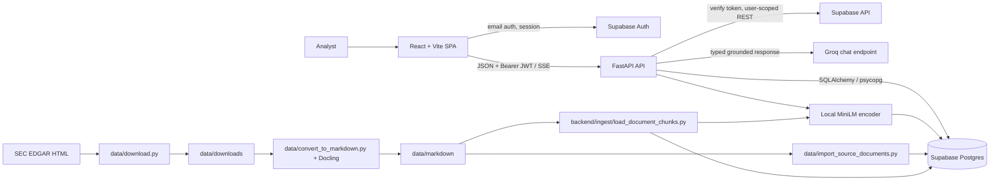
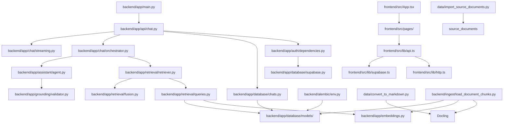
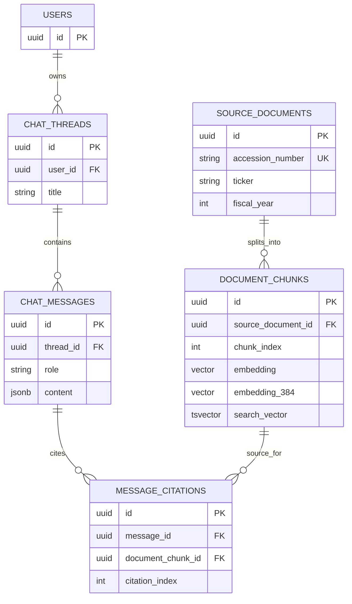
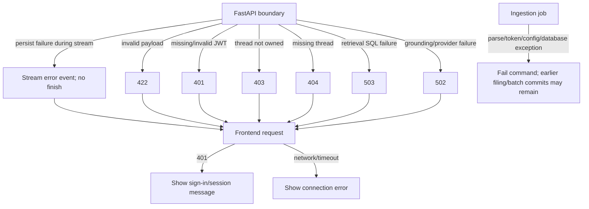

# System Architecture

This document describes code that currently exists. The source of truth is the implementation under `backend/`, `frontend/`, and `data/`; planned work and verification gaps are listed in [todos.md](todos.md).

## Product boundary and stack

Document Copilot answers analyst questions using a curated SEC filing corpus. It is designed to show the evidence behind each answer, not to add external market data or investment recommendations.

| Technology | Actual role |
| --- | --- |
| React 19, TypeScript, Vite | Browser application, route-level views, static development/build. |
| React Router | Sign-in/sign-up and protected `/chat` and `/chat/:threadId` routes. |
| Supabase JS | Browser email authentication and session retrieval. |
| Native `fetch` + custom API/SSE client | JSON calls, bearer-token forwarding, and streaming; no AI SDK package is installed. |
| FastAPI + Pydantic | HTTP routes, dependency injection, and request validation. |
| Supabase Python client | Auth user lookup and user-scoped REST operations. |
| SQLAlchemy + psycopg + Alembic | Relational mapping, PostgreSQL sessions, and schema migrations. |
| Supabase Postgres + pgvector | Durable app data, vector similarity, and generated full-text search. |
| Sentence Transformers `sentence-transformers/all-MiniLM-L6-v2` | Local document/query vectors; one cached model, normalized vectors of 384 dimensions. |
| Docling | HTML-to-Markdown conversion and hierarchical/hybrid Markdown chunking. |
| PydanticAI + OpenAI-compatible Python SDK | Typed answer agent using Groq's compatible endpoint. The `openai` package is a transport SDK here, not an OpenAI provider dependency. |
| pytest + Ruff / ESLint + TypeScript | Backend unit tests and code checks; frontend lint, type-check, and Vite build. |

`structlog` is declared but is not currently used for structured application logging. Railway appears in project planning, but deployment configuration is not present in the inspected tree.

## Diagram 1 — system architecture



The browser contains only public Supabase configuration. Groq, service-role and direct database credentials belong in backend configuration. Ingestion is a separate local workflow, not an HTTP route.

## Diagram 2 — source-code dependency map



This is the import/call structure, not a generic layered architecture. There is no separate backend service/repository package: route handlers coordinate dependencies and call `chat.orchestrator`, `database.chats`, retrieval, and persistence helpers directly.

## Diagram 3 — ingestion flow

```mermaid
flowchart LR
  SEC[SEC EDGAR] --> D[uv run data/download.py]
  D --> H[year-organized HTML + manifest]
  H --> C[uv run --project backend --extra ingest python data/convert_to_markdown.py]
  C --> M[year-organized Markdown + manifest]
  M --> S[python data/import_source_documents.py]
  S --> SD[(source_documents via Supabase REST upsert)]
  M --> L[python -m ingest.load_document_chunks]
  SD --> L
  L --> Parse[Docling DocumentConverter for Markdown]
  Parse --> Chunk[Hierarchical count + HybridChunker output]
  Chunk --> E[MiniLM encode, 384 dimensions]
  E --> W[SQLAlchemy batch commits]
  W --> DC[(document_chunks: embedding_384 + generated search_vector)]
```



See [Ingestion and retrieval](INGESTION_AND_RETRIEVAL.md) for modes, limits, idempotency, vector dimensions, and verification boundaries. The source import uses Supabase REST upserts; chunk writes use SQLAlchemy transactions in small batches. The pipeline has no global transaction across every filing.

## Diagram 4 — user-query execution

```mermaid
sequenceDiagram
  actor U as Analyst
  participant UI as React ChatWorkspace
  participant API as FastAPI /chat/stream
  participant Auth as Supabase Auth
  participant R as DocumentRetriever
  participant DB as PostgreSQL
  participant Agent as PydanticAI
  participant G as Groq
  U->>UI: Enter question
  UI->>API: POST threadId + messages + bearer JWT
  API->>Auth: get_current_user(token)
  API->>DB: verify thread owner
  API->>R: search(query)
  R->>DB: vector search + English full-text search
  R->>R: reciprocal-rank fusion + neighbors
  API->>Agent: prepare evidence/dependencies
  Agent->>G: generate typed GroundedAnswer; invoke bounded tools as needed
  Agent-->>API: answer + citation references
  API->>API: validate citation IDs/excerpts and derive trusted metadata
  API-->>UI: text delta events + data-citations + finish
  API->>DB: persist user/assistant messages, citations, thread timestamp
  UI->>API: reload persisted message history
  UI-->>U: answer, citation controls, source excerpt panel
```

The implementation validates the complete agent result before streaming text. During streaming, persistence happens after answer/citation events have been yielded and before the final finish event. The frontend reloads history after a successful completed stream. If persistence fails, it receives a stream error event.

## Diagram 5 — database relationships



Actual constraints and behavior:

- SQLAlchemy models are in `backend/app/database/models/`; Alembic owns schema changes.
- `users.id` is the application copy of the Supabase Auth user ID; migration 0001 does not create a foreign key to `auth.users`.
- A unique constraint prevents duplicate chunk indices per source document. Citation indices are unique per message.
- `document_chunks.embedding` is legacy `vector(1536)`; `embedding_384` is `vector(384)` and is the column queried by current semantic retrieval. Both vector HNSW indexes are defined in migrations; the full-text column is generated from English `chunk_text` and has a GIN index.
- Migration 0001 enables RLS and creates policies; migration 0002 checks the existing 1536 column and adds the 384 column/index without replacing old vectors.
- Normal user reads/writes use the bearer-token Supabase client. Thread-owner verification and atomic chat persistence use backend PostgreSQL/service-role operations and compare the authenticated user ID.

## Diagram 6 — error and failure boundaries



HTTP failure mapping is based on `backend/app/api/chat.py`; persistence has its own streaming error event. Ingestion is a command-line process and fails at the stage reporting the error. Already committed source rows/chunk batches are not rolled back as a corpus-wide transaction.

## Request and security boundaries

- Browser Supabase credentials are the URL and anon/public key only. `VITE_*` values are embedded in the browser build; they must never contain `GROQ_API_KEY`, `SUPABASE_SERVICE_ROLE_KEY`, or `DATABASE_URL`.
- FastAPI reads backend settings through `backend/app/config.py`. `get_current_user` validates the Supabase bearer token by querying Supabase Auth.
- The Groq provider is created lazily by `assistant.agent.get_agent()` using the OpenAI-compatible PydanticAI provider and `GROQ_BASE_URL`. Despite the SDK import name, answer generation is configured for Groq.
- Ingestion writes source documents using the Supabase service-role client and chunks using `DATABASE_URL`; both operations are intended for trusted local/operator execution, not browser requests.
- All answer citations must reference passages supplied to the current request, and their exact excerpt must occur in the referenced passage. The frontend only turns known `[n]` markers into citation controls and restricts external filing links to SEC HTTPS URLs.

## Current gaps and verification status

- No reranker exists; current retrieval is vector + full-text + RRF + neighboring chunks.
- The frontend uses its own `fetch` SSE parser; Vercel AI SDK chat primitives are not installed.
- The typed output has `answer`, `citations`, and `insufficient_evidence`; there is no structured table payload.
- `GROQ_GROUNDING_MODEL` and `RETRIEVAL_FTS_KEYWORD_MODEL` are settings/example entries but are not consumed by current runtime logic. `structlog` is declared but no structured logger is configured.
- The corpus script has a `--dry-run`, `--pilot`, and `--all`; only a prior one-chunk pilot is reported in the conversation, not independently verified against this checked-out database. Full-corpus ingestion, integration search quality, all client-brief questions, and deployed hosting are not confirmed by this documentation audit.
- The historical PostgreSQL connection-error transcript referenced in the task was not found in repository files. Therefore its exact cause remains unverified; see [the ingestion guide](INGESTION_AND_RETRIEVAL.md).

## Related documents

- [Request lifecycle](REQUEST_LIFECYCLE.md)
- [Ingestion and retrieval](INGESTION_AND_RETRIEVAL.md)
- [Client brief](client-brief.md)
- [Implementation checklist](todos.md)
- [Setup guides](guides/)
