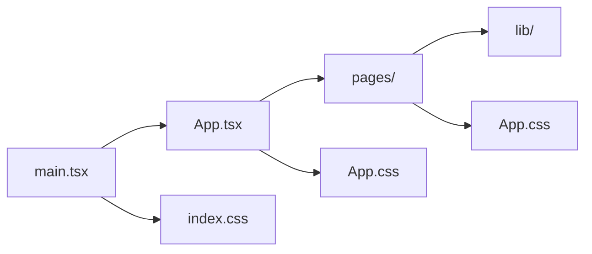

# `frontend/src`

React application source. `main.tsx` imports global CSS and mounts `App.tsx`; `App.tsx` owns session observation, route definitions, and protected-route redirects. `index.css` has global browser/theme rules; `App.css` styles auth and chat views.

| File | Purpose |
| --- | --- |
| `main.tsx` | React root/bootstrap; imports global CSS and renders `App`. |
| `App.tsx` | Session listener, browser router, public auth routes, and protected chat routes. |
| `index.css` | Global typography, base layout, color variables, and responsive defaults. |
| `App.css` | Auth forms, chat workspace, message/citation states, and source-panel styling. |

Subdirectories: [`pages/`](pages/README.md) contains route views, [`lib/`](lib/README.md) contains auth/config/API clients, and [`assets/`](assets/README.md) holds imported images/icons. Keep auth/session and backend message contracts consistent across these paths.
