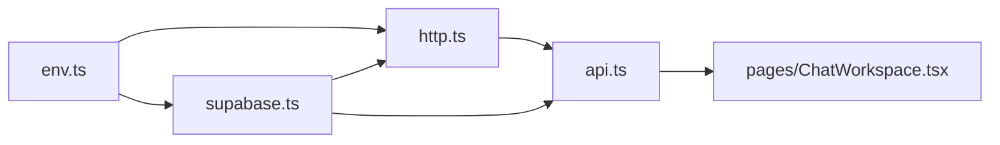

# Frontend libraries

| File | Purpose |
| --- | --- |
| `env.ts` | Validates and exports required `VITE_*` browser configuration. |
| `supabase.ts` | Creates the browser Supabase Auth client from validated configuration. |
| `http.ts` | Native fetch JSON wrapper, bearer token, origin check, timeout, and `ApiError`. |
| `api.ts` | Product chat/thread types and API methods; parses backend chat SSE and citations. |

Do not read `import.meta.env` elsewhere or add another networking dependency. Keep stream event and citation shapes synchronized with the backend API.
