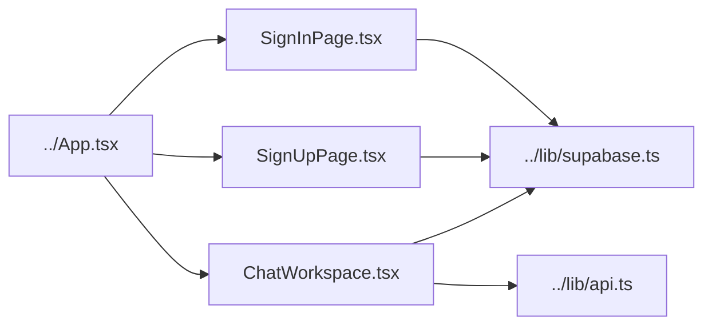

# Route pages

| File | Role and connections |
| --- | --- |
| `SignInPage.tsx` | Email/password form; calls `supabase.auth.signInWithPassword()` and navigates to `/chat`. |
| `SignUpPage.tsx` | Email/password confirmation form; calls `supabase.auth.signUp()` and handles email confirmation/session state. |
| `ChatWorkspace.tsx` | Protected chat shell; loads threads/messages through `lib/api.ts`, streams messages, renders citation markers and source panel, and signs out. |

`App.tsx` gates `/chat` and `/chat/:threadId` on Supabase session state. Preserve path and `threadId` behavior; the backend owns chat authorization and answer grounding.
